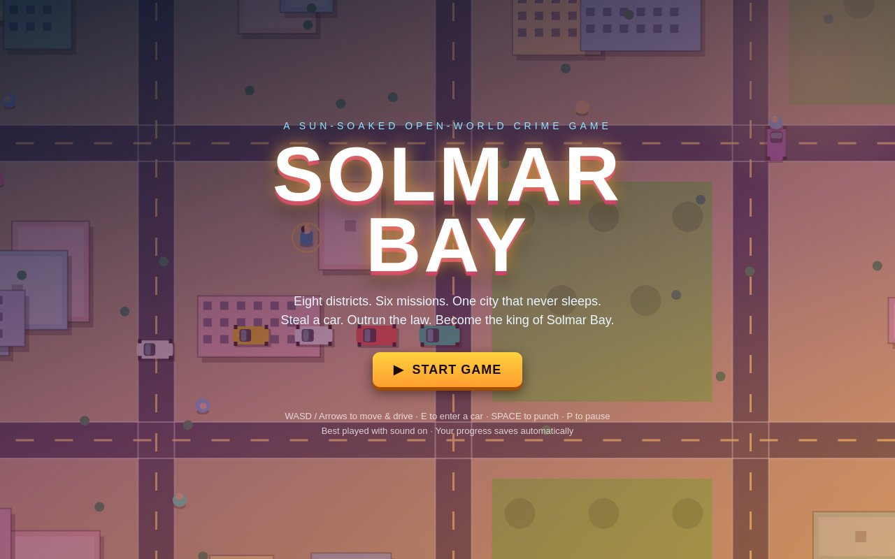
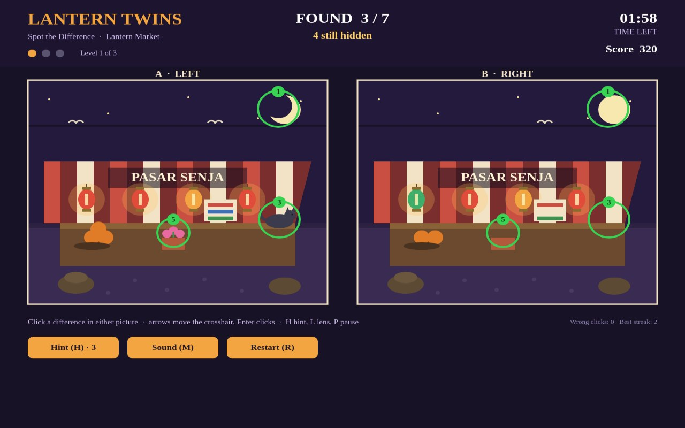
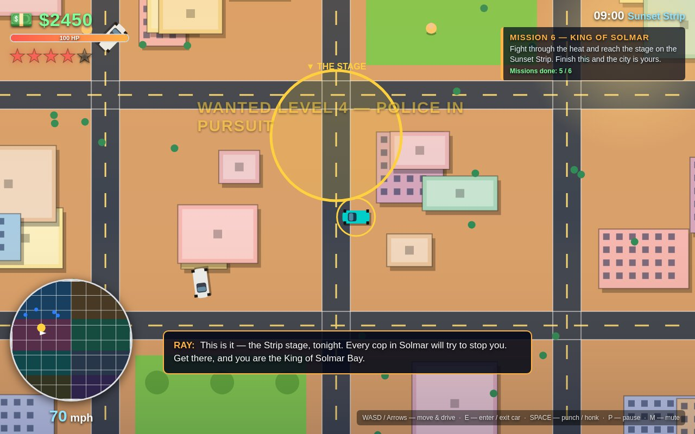
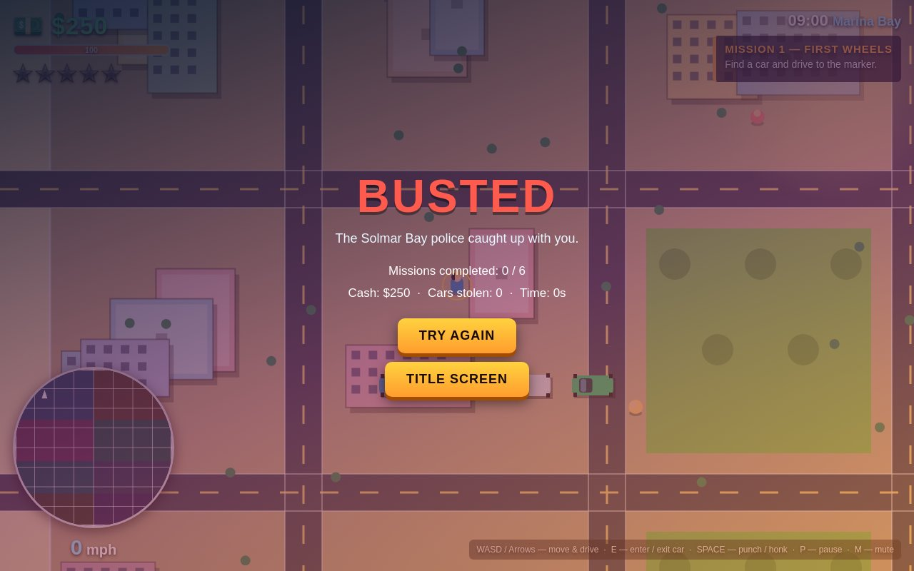

# SOLMAR BAY — Open-World Crime Game

[](https://make.fun/c/gta6-01)
[](https://github.com/Indrawan89/hallo-guys-welcome-to-my-github)
[](https://make.fun/c/gta6-01)

An original top-down open-world crime game for the **make.fun gta6-01** competition ("Make GTA 6", $1,666 across the top 100). No Rockstar names, art, or assets — Solmar Bay is a city of its own: eight districts, six story missions, traffic, pedestrians, police chases, and a wanted system, all running offline from static files in a desktop browser.

## Play

```sh
node serve.ts        # serves game/ at http://localhost:8080
```

Or open `game/index.html` through any static file server. No build step, no network requests, no libraries — pure HTML, CSS, and canvas JavaScript with WebAudio beeps.

| Key | Action |
| --- | --- |
| WASD / Arrow keys | Walk / drive |
| E | Enter or exit the nearest car (stealing one raises your wanted level) |
| SPACE | Punch on foot / honk while driving |
| P | Pause (auto-saves) |
| M | Mute |
| R | Restart after BUSTED / WASTED |

## The city

Eight districts across a 3400×3400 world: **Marina Bay, Old Town, Sunset Strip, Palm Court, Harbor Lights, Dockside, North Hills, University Quarter** — beaches, parks, palm trees, a road grid, traffic, and pedestrians who flee when you cause trouble.

## Story — 6 missions

1. **First Wheels** — steal a car and meet Ray at the marina.
2. **Delivery Run** — move a package to Old Town without smashing it.
3. **Shakedown** — collect 3 cash stashes on the Sunset Strip, past Lena's goons.
4. **Heat Rising** — lose your wanted level, then reach the Harbor Lights safehouse.
5. **The Harbor Deal** — grab the briefcase at Dockside and get out clean.
6. **King of Solmar** — fight through the heat to the Strip stage and take the city.

## Systems

- **Wanted 0–5 stars** — crimes raise the heat; police cars spawn and ram you; hiding in parks and staying out of sight cools it down. Get caught on foot at high wanted and you're BUSTED.
- **Vehicles** — 5 car models with different speed and handling; traffic AI drives the road grid; parked cars wait near your spawn.
- **Combat** — punch goons and pedestrians (that last one is a crime), get shoved back by dock guards, run over pedestrians at speed (also a crime).
- **Economy** — cash and health pickups, mission rewards, crash penalties on the delivery run.
- **HUD** — money, health bar, wanted stars, in-game clock, district name, mission tracker, speedometer, and a live circular minimap with the mission marker and police blips.
- **Save** — progress auto-saves to localStorage; continue from the title screen.
- **Sound** — WebAudio synth: coins, punches, crashes, sirens, mission fanfares. No audio files.

## Files

- `game/index.html`, `game/style.css`, `game/game.js` — the whole game (~950 lines, one file, no dependencies)
- `main.ts` — entry program: copies `game/` + `screenshots/` to `/output` and writes `dossier.json` via `vendor/makefun-game.ts` (deterministic, run it twice, same bytes)
- `serve.ts` — static server for local play
- `screenshots/` — 4 real renders of the game (title, on-foot mission, police chase, busted)
- `DOSSIER.md` — what the game is and how it was built

## Screenshots

| | |
| --- | --- |
|  |  |
|  |  |

Referral: `sh0dz3eg`
